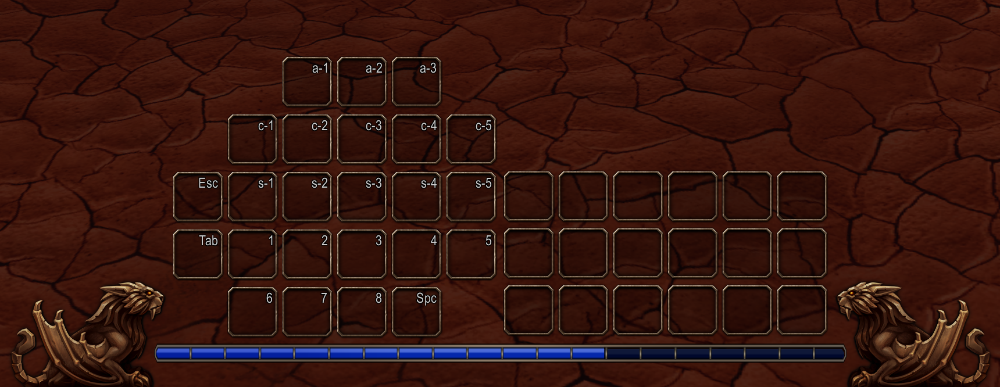
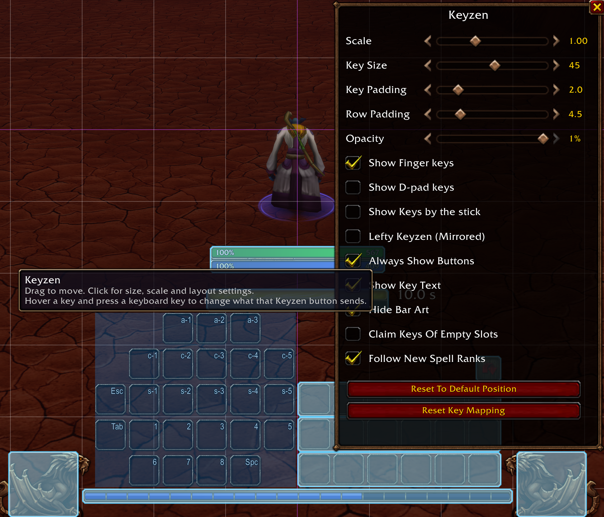

# Keyzen – your Azeron Keyzen as an action bar (WoW Forever)

Keyzen draws the Azeron Keyzen keypad on your screen, using the same art as the default action
bars. Drag spells, items or macros onto the keys, and pressing that key on the Keyzen uses them.
No action bar pages, no keybinding menus: the picture of your keypad *is* your keybinding setup.



* Works on World of Warcraft **Forever** (interface 16001) and the current retail client.
* Looks like a Blizzard bar: slot art, icon frames, hotkey and count text, range and usability colouring.
* Lives in Blizzard's **Edit Mode**: move it, snap it to the other bars, click it for its settings.
* Show the whole keypad or only part of it (finger keys, d-pad, keys by the stick).
* Standard and Lefty (mirrored) Keyzen layouts, taken 1:1 from the Azeron Software.
* Combat safe: secure action buttons and override bindings; changes are queued until combat ends.
* Spell ranks follow automatically when you learn a higher rank.
* Key contents are saved per character; layout and key mapping are account-wide.
* Ships with an Azeron Software profile that sends exactly the keys the addon expects.

## Install

1. Download or clone this repository and put its contents in a folder named **`Keyzen`** at
   `World of Warcraft\_forever_\Interface\AddOns\Keyzen`
   (for retail: `World of Warcraft\_retail_\Interface\AddOns\Keyzen`). The folder name must be
   `Keyzen`, matching `Keyzen.toc`.
2. In the Azeron Software, import `AzeronProfile\Keyzen-WoW.json`
   (Profiles list → list edit mode → *Import profiles* → pick the .json, tick the profile, confirm).
   The file is in the same format the software writes with *Export selected profiles to .json*.
   Activate the **Keyzen WoW Addon** profile. The thumbstick keeps its WASD movement.
3. Start the game. The Keyzen frame appears above the bottom bars.

## Usage guide

### 1. Put spells on the keys

Open your spellbook, bags or macro window and drag a spell, item or macro onto a key. It works
exactly like dropping something on a Blizzard action bar:

* Drop on an empty key to place it.
* Drop on an occupied key to swap: the old content goes to your cursor.
* Drag something off a key to remove it. If *Lock Action Bars* is enabled in the game
  options, hold the pickup modifier (Shift by default), the same as for the Blizzard bars.

The key text in the corner (`1`, `s-1`, `c-1`, `a-1`, `Tab`, `Spc`) tells you which Keyzen
button sends that key. Press it on the Keyzen and the spell is cast.

### 2. Place and size the frame in Edit Mode

Open Edit Mode from the game menu (or type `/keyzen`). The Keyzen frame gets the same blue
selection overlay as every other HUD element.



* **Move**: drag the frame. With snapping enabled it snaps to the bars and to screen edges,
  and the bars snap to it.
* **Settings**: click the frame once. A settings dialog opens on the right side of the screen,
  the same kind the action bars use. It can be dragged around and closed with the X.

| Setting | What it does |
| --- | --- |
| Scale | Overall size of the frame |
| Key Size | Size of one key; 45 is the Blizzard action button size |
| Key Padding / Row Padding | Space between keys and between rows, in 0.5 steps, so the rows can line up with stacked bars |
| Opacity | Transparency of the whole frame |
| Show Finger keys / D-pad keys / Keys by the stick | Which parts of the keypad are drawn. Finger keys only is exactly 6 keys wide |
| Lefty Keyzen (Mirrored) | Mirrored layout for the right-handed Keyzen |
| Always Show Buttons | Draw empty keys outside Edit Mode, like the Blizzard option |
| Show Key Text | Show the key name in the corner of each key |
| Hide Bar Art | Hide the emblem art inside empty keys, like the Blizzard option |
| Claim Keys Of Empty Slots | Empty keys do nothing instead of falling through to the Blizzard bars |
| Follow New Spell Ranks | Switch a key to the new rank when you learn one |
| Reset To Default Position / Reset Key Mapping | Back to the defaults |

Tip for the layout in the screenshots: set the three Blizzard bars to 6 icons each, show only
the finger keys, and raise *Row Padding* until the Keyzen rows line up with the bars.

### 3. Change which key a Keyzen button sends

While Edit Mode is open, hover a key and press a keyboard key (with Shift, Ctrl or Alt if you
like). That Keyzen button now expects that key; press Escape to give it no key. The Azeron
profile has to send the same key, so change it in the Azeron Software too. `/keyzen keys`
lists the whole mapping in chat.

Keys with nothing on them fall through to your normal Blizzard bindings, so you can mix the
Keyzen frame with regular action bars.

### Commands

| Command | Effect |
| --- | --- |
| `/keyzen` (or `/kz`) | Open Edit Mode |
| `/keyzen config` | Open the options panel (Interface → AddOns → Keyzen) |
| `/keyzen show` / `hide` | Show or hide the frame (hiding releases its keybinds) |
| `/keyzen lefty` | Toggle the mirrored layout |
| `/keyzen keys` | List which WoW key each Keyzen button sends |
| `/keyzen key <button> <KEY>` | Set a key from chat, e.g. `/keyzen key 18 SPACE` |
| `/keyzen resetkeys` | Restore the default key mapping |
| `/keyzen reset` | Reset position, scale and size |
| `/keyzen clear` | Remove all spells from the keys (this character) |

## Default key mapping

As you look at the keypad (left hand on the device, thumb cluster and stick on the right):

```
 outer  pinky    ring     middle   index    thumb    |------ d-pad / side ------|
  .       .        .        .        .        .        .      UP       .
  .       .      ALT-1    ALT-2    ALT-3      .      LEFT   ALT-4    RIGHT
  .     CTRL-1   CTRL-2   CTRL-3   CTRL-4   CTRL-5     .     DOWN      .
 ESC    SHIFT-1  SHIFT-2  SHIFT-3  SHIFT-4  SHIFT-5  (stick)   .     ALT-5
  1       2        3        4        5        6      (stick)   .     ALT-6
  .       7        8       TAB     SPACE      .      ALT-7     .       .
```

The profile-switch button and the thumbstick (WASD movement) are left alone by the addon and
not drawn. Escape is shown on its key but never claimed, since WoW does not allow binding it;
it keeps opening the menu and cancelling casts. The same table lives in `Layout.lua` (`ns.DEFAULT_KEYS`) and is what
`tools/make-azeron-profile.js` writes into the Azeron profile.

## For developers

* `Layout.lua` – the two Keyzen grids (from the Azeron Software mapper), button codes, names, sections, default keys.
* `Keyzen.lua` – frame, secure buttons, drag and drop, bindings, Edit Mode integration, events, slash commands.
* `Options.lua` – the Edit Mode settings dialog and the Interface options panel.
* `tools/make-azeron-profile.js <template.json>` – regenerates `AzeronProfile/Keyzen-WoW.json`
  from any existing Keyzen profile file (structure is copied, keys come from `Layout.lua`).

Button codes (Azeron numbering) in the standard grid:

```
 21  .   .   .   .   .   .  28   .
  .  .   8  12  17   .  29  22  31
  .  3   7  11  16  19   .  30   .
  4  2   6  10  15  42  24  24  20
 36  1   5   9  14  43  24  24  41
  .  37 38  13  18   .  23   .   .
```

21 = profile switch, 24 = thumbstick (not used by the addon).
